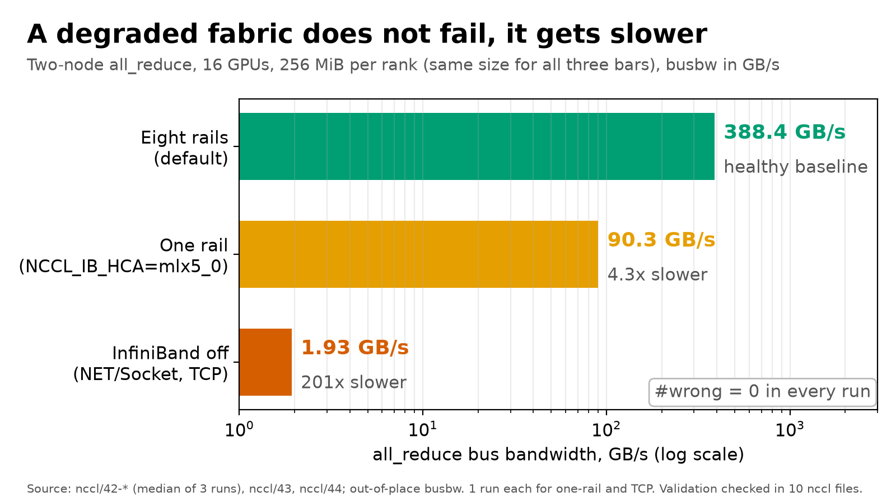
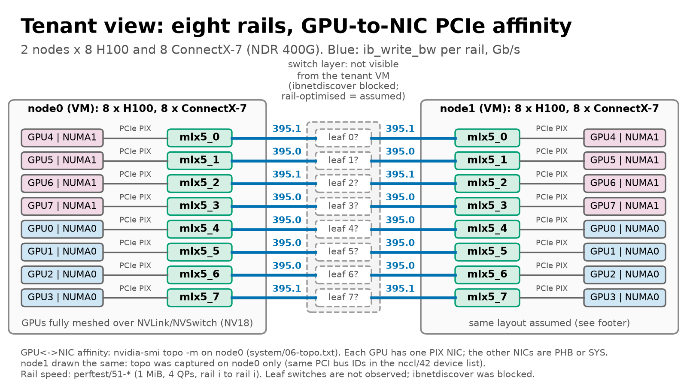
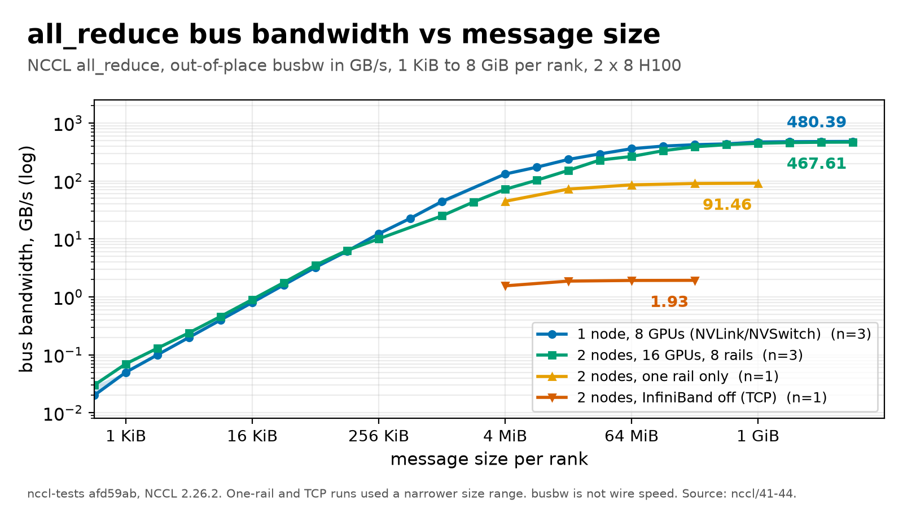
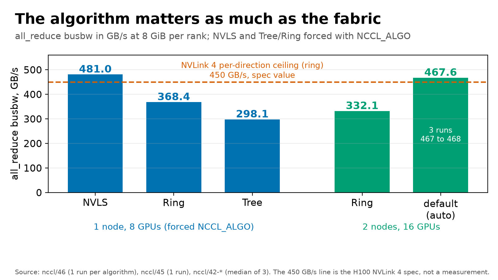
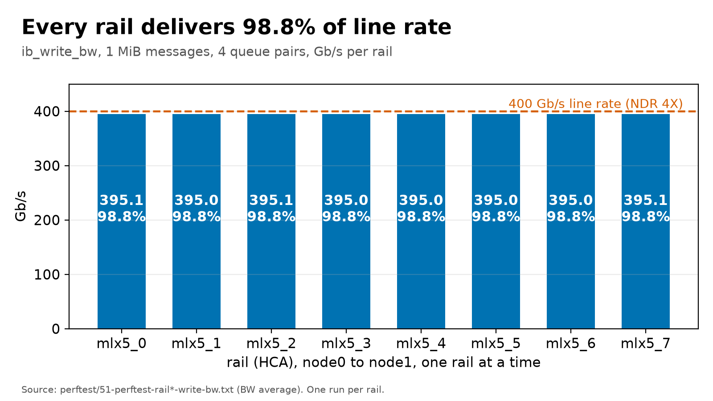
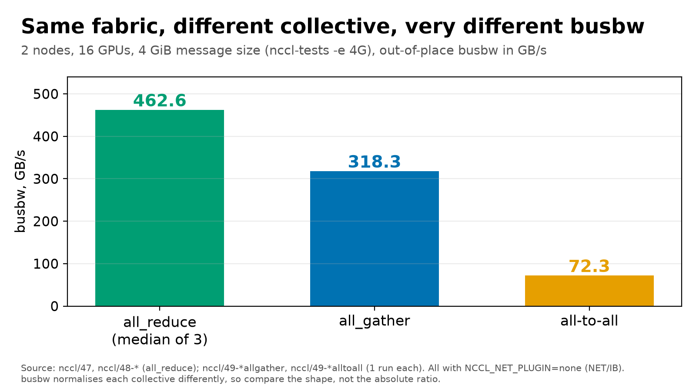
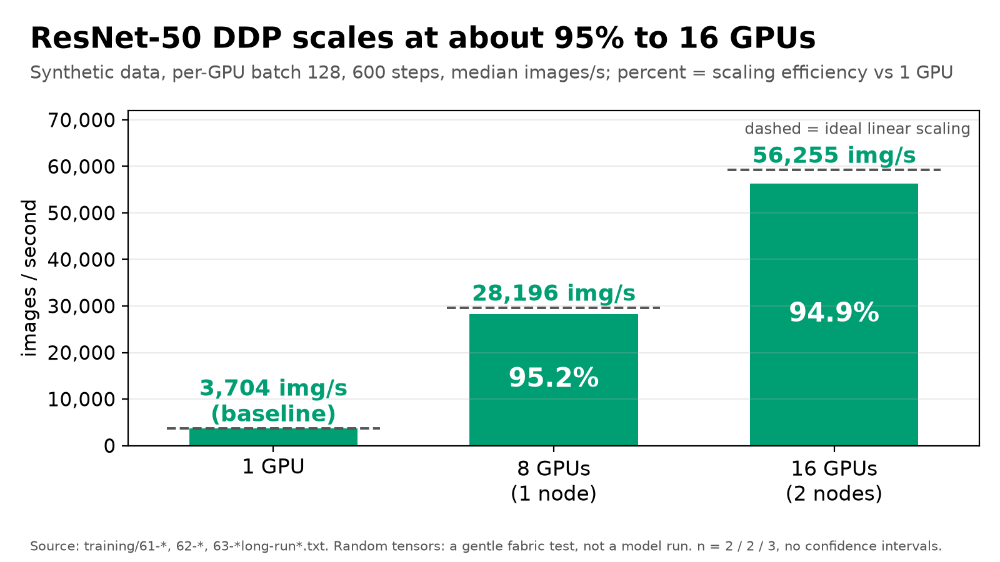

# GPU fleet operations scaffold

This is a self-directed study of GPU-fleet operations. It holds three code deliverables:
D1, a DCGM observability stack; D3, an H100 node acceptance sequence; and D4, a controlled DDP
checkpoint/failure study. (D2 was a written reference on reliability figures from the
literature, not code, so it is not in this repository.) It also holds the real results of one
rented 2 x 8 H100 InfiniBand run on 12 Oct 2026, scrubbed, in `results/`. It favours plain
Bash and Python and keeps other generated results out of Git. Claims are tied to files; what
was not tested is stated at the end.

Built with Claude Code as a pair programmer; the runs, choices and review are mine.

## At a glance

One real run: 2 rented VMs, 16 H100 GPUs, 8 x 400 Gb/s InfiniBand rails. Every figure is drawn by
`plots/plot_lab2.py` from the raw files in [`results/2026-10-12-2x8xH100-ib/`](results/2026-10-12-2x8xH100-ib/); nothing is typed in by hand.
At most 3 runs per configuration and no confidence intervals; HPL, OSU micro-benchmarks and
nvbandwidth were not run, and the VM has no switch-side access (see the caveats at the end).



*Hero.* Two-node all_reduce at 256 MiB: eight rails 388.4 GB/s, one rail 90.3 GB/s (4.3x slower),
InfiniBand off 1.93 GB/s (201x slower), with `#wrong = 0` throughout. Source:
[`nccl/42-*`](results/2026-10-12-2x8xH100-ib/nccl/), [`43`](results/2026-10-12-2x8xH100-ib/nccl/43-nccl-inject-one-rail.txt),
[`44`](results/2026-10-12-2x8xH100-ib/nccl/44-nccl-inject-ib-disabled.txt).



*Topology as the tenant sees it.* Each GPU has exactly one PCIe-affine NIC (GPU0 with mlx5_4, not
mlx5_0), 395 Gb/s per rail; the switch layer is dashed because it cannot be seen from the VM.
Source: [`system/06-topo.txt`](results/2026-10-12-2x8xH100-ib/system/06-topo.txt), [`perftest/51-*`](results/2026-10-12-2x8xH100-ib/perftest/).



*Bandwidth vs message size.* 1 node (NVLink) vs 2 nodes vs one rail vs TCP, 1 KiB to 8 GiB. Source:
[`nccl/41` to `44`](results/2026-10-12-2x8xH100-ib/nccl/).



*Algorithm choice.* One node at 8 GiB: NVLS 481.0, Ring 368.4, Tree 298.1 GB/s; two nodes Ring
332.1 vs default 467.6. Source: [`nccl/46`](results/2026-10-12-2x8xH100-ib/nccl/46-nccl-single-algo.txt),
[`45`](results/2026-10-12-2x8xH100-ib/nccl/45-nccl-multi-ring.txt), [`42-*`](results/2026-10-12-2x8xH100-ib/nccl/). The 450 GB/s line is a spec value.



*Per-rail RDMA write bandwidth.* 395.0 to 395.1 Gb/s on each of 8 rails, 98.8% of 400. Source:
[`perftest/51-*`](results/2026-10-12-2x8xH100-ib/perftest/).



*Collectives at 4 GiB, 16 GPUs.* all_reduce 462.6, all_gather 318.3, all-to-all 72.3 GB/s busbw.
Source: [`nccl/47`, `48-*`](results/2026-10-12-2x8xH100-ib/nccl/), [`49-*`](results/2026-10-12-2x8xH100-ib/nccl/).



*Training scaling.* ResNet-50 on synthetic data: 3,704 / 28,196 / 56,255 img/s at 1 / 8 / 16 GPUs,
95.2% and 94.9% scaling efficiency. Source: [`training/`](results/2026-10-12-2x8xH100-ib/training/).

## Layout

- `d1-observability/` — pinned DCGM Exporter, Prometheus, Grafana provisioning,
  GPU alerts/dashboard, and a baseline capture script.
- `d3-acceptance/` — ordered inventory/DCGM/NCCL/HPL/InfiniBand stages, pass/fail
  runbook, result parser, and clearly labelled synthetic parser fixtures.
- `d4-failure-injection/` — deterministic torchrun DDP workload, periodic atomic
  checkpoints, guarded fault injection, measurements, and experiment method.
- `results/2026-10-12-2x8xH100-ib/` — curated raw output, summary, scrub log and plots from the
  one real 2 x 8 H100 InfiniBand run; `bin/curate_lab2.py` builds it, `plots/plot_lab2.py`
  plots it.
- `PROJECT_STATE.md`, `TASKS.md`, and `DECISIONS.md` — durable implementation,
  validation, and decision state.

## Run

Start D1 on a Linux GPU host with NVIDIA Container Toolkit:

```bash
cd d1-observability
export GRAFANA_ADMIN_PASSWORD='set-outside-git'
docker compose config
docker compose up -d
./baseline.sh --dry-run
```

Prepare D3 completely before creating a paid cluster. On each target node use
one shared run ID, follow `d3-acceptance/RUNBOOK.md`, and only replace the
threshold placeholders with exact provider/vendor citations:

```bash
cd d3-acceptance
export RUN_ID=$(date -u +%Y%m%dT%H%M%SZ)
./00-inventory.sh --dry-run
./10-dcgm-diag.sh --dry-run
./20-nccl-tests.sh --dry-run --launcher mpirun --hosts node-a:8,node-b:8
./30-hpl.sh --dry-run
./40-fabric.sh --dry-run --wait-seconds 0
./90-report.py --dry-run
```

For D4, read `d4-failure-injection/METHOD.md` before using any real signal or
network action. A typical preparation check is:

```bash
cd d4-failure-injection
./train.py --dry-run --checkpoint-interval 25
./inject.sh --dry-run --action kill --rank 1
./measure.py --results-dir tests/fixtures
```

Each subdirectory README gives prerequisites, exact commands, capability
limits, and the evidence still needed.

## What ran on real H100s (12 Oct 2026)

Two rented VMs on one GPU cluster, each 8 x H100 80GB HBM3 with 8 InfiniBand HCAs at 400 Gb/s
(NDR 4X). The fabric and NCCL runs were driven by the `lab2` scripts (copied into the results
folder), not by the D1/D3/D4 scaffolding above. Curated, scrubbed raw output, a manifest and the
plots live in [`results/2026-10-12-2x8xH100-ib/`](results/2026-10-12-2x8xH100-ib/); the full
table with caveats is in its [`SUMMARY.md`](results/2026-10-12-2x8xH100-ib/SUMMARY.md).

| Measurement | Result | Raw |
|---|---|---|
| `ib_write_bw`, 8 rails, 1 MiB | 395.0 to 395.1 Gb/s each, 98.8% of 400 | [perftest/](results/2026-10-12-2x8xH100-ib/perftest/) |
| all_reduce, 1 node, 8 GiB, busbw | 480.5 GB/s (3 runs, spread under 0.1%) | [nccl/41-*](results/2026-10-12-2x8xH100-ib/nccl/) |
| all_reduce, 2 nodes, 8 GiB, busbw | 466.8 to 468.0 GB/s (3 runs) | [nccl/42-*](results/2026-10-12-2x8xH100-ib/nccl/) |
| 2 nodes, one rail only, 1 GiB | 91.5 GB/s | [nccl/43](results/2026-10-12-2x8xH100-ib/nccl/43-nccl-inject-one-rail.txt) |
| 2 nodes, InfiniBand off (TCP), 256 MiB | 1.93 GB/s | [nccl/44](results/2026-10-12-2x8xH100-ib/nccl/44-nccl-inject-ib-disabled.txt) |
| all_gather / all-to-all, 16 GPUs, 4 GiB | 318.3 / 72.3 GB/s | [nccl/49-*](results/2026-10-12-2x8xH100-ib/nccl/) |
| ResNet-50 DDP, 1 / 8 / 16 GPUs | 3,704 / 28,196 / 56,255 img/s | [training/](results/2026-10-12-2x8xH100-ib/training/) |

Plots (all of the figures above): [`plots/`](results/2026-10-12-2x8xH100-ib/plots/), produced by
`plots/plot_lab2.py` from the raw files (no measured number is hardcoded).
Re-create the curated folder with `bin/curate_lab2.py`.

## What was not tested

- **Not run:** HPL, OSU micro-benchmarks, nvbandwidth, DCGM diagnostics, the D1 exporter on an
  H100, and the D3 acceptance runbook as written.
- **Blocked in the VM:** `ibdiagnet`, `ibnetdiscover`, `sminfo`, `iblinkinfo`, `ibqueryerrors`
  cannot open a management port. The nodes are KVM VMs and each HCA is a ConnectX SR-IOV
  virtual function (`system/08-lspci.txt`; `ibstat` reports CA type MT4126), and a VF has no
  subnet-management access, so this is a limit of the VM, not a fabric fault. In
  `ibdev2netdev` the "(Down)" refers to the IPoIB netdevs, not the IB ports (Active, 400 Gb/s
  in `system/10-ibstat.txt`). `system/24-ibdiagnet.txt` reports 0 nodes and is evidence of
  nothing. The fabric view is endpoint-side only. GPU-memory perftest (`--use_cuda`) was not
  available in the perftest build.
- **D4 failure injection (checkpoint/kill/resume on GPUs): not run.** It still has only the
  2026-09-09 one-rank CPU/Gloo evidence. The "failure injection" in the results folder is a
  transport study (one rail, then no InfiniBand), done with NCCL settings, not process or
  network faults.
- **Caveats on what did run:** node1 was recreated twice (first on a different image, then not
  attached to the GPU cluster) and the first perftest pass was re-run against the final node1; default
  multi-node runs exit 139 at teardown (the `NCCL_NET_PLUGIN=none` runs exit 0 at the same
  speed, cause not investigated); at most 3 runs per configuration, 1 for most; the perftest
  size sweep failed just above 1 MiB in the first pass; ResNet-50 is on synthetic data; the nccl-tests runs used NCCL 2.26.2 but the
  PyTorch training job used PyTorch's bundled NCCL 2.28.9.
- Everything in the D1/D3/D4 folders other than the above is unchanged from the 2026-09-09
  review: dry-run, shellcheck, synthetic parser fixtures, and a CPU/Gloo recovery exercise. The
  fixture numbers under `d3-acceptance/tests/` and `d4-failure-injection/tests/` are synthetic
  and are not results.
